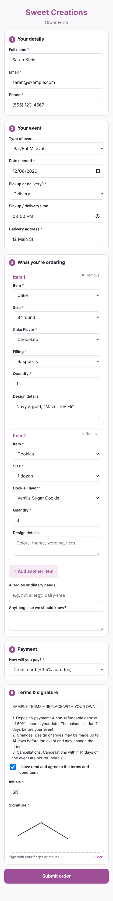

# Custom Dessert Order System

One Google Sheet that runs your whole order flow:

| When… | It automatically… |
|---|---|
| A customer submits the order form | Saves the order to the **Orders** tab with a clean summary |
| | Saves a **signed PDF** (their answers, the terms, their initials and signature) to Google Drive and emails them a copy |
| | Adds the pickup/delivery to your **Google Calendar** (gray = not confirmed yet) |
| | Creates a **draft invoice in Square**, with the 3.5% fee added when they pick credit card |
| | Works out the **ingredients** from your recipes and emails you right away if you're **short** |
| You change an order's Status to **Confirmed** | Calendar entry turns green |
| You change Status to **Done** | Ingredients come out of your inventory |
| You change Status to **Cancelled** | Calendar entry is marked cancelled and its ingredients are released |
| **Every Sunday at 7am** | Emails you a **shopping list**, this week's orders, and your full inventory |

Nothing goes to the customer from Square until **you** press Send on the draft invoice, so you can still adjust the price for custom work.

---

## Setup (about 15 minutes, one time)

### 1. Make the sheet
1. Go to **sheets.new** to create a blank Google Sheet. Name it something like "Orders".
2. Menu **Extensions → Apps Script**.

### 2. Paste in the code
1. In the Apps Script window, delete what's in `Code.gs` and paste in everything from **Code.gs** (this folder).
2. Click **+** next to "Files" → **HTML**, name it exactly `Form` (no extension), and paste in everything from **Form.html**.
3. Click 💾 Save.

### 3. Run setup
1. In the toolbar's function dropdown pick **setup**, then press **▶ Run**.
2. Google will ask for permission. Click **Review permissions → your account → Advanced → Go to (project) → Allow**. ("Unverified app" just means you wrote it yourself.)
3. Go back to the sheet and refresh. You'll see the new tabs, filled with **sample data**, and a **🎂 Orders** menu.

### 4. Publish the form link
1. In Apps Script: **Deploy → New deployment → ⚙️ → Web app**.
2. *Execute as:* **Me**. *Who has access:* **Anyone**.
3. Click **Deploy** and copy the **Web app URL**. That's the link you send customers.
   - Tip: shorten it (e.g. bit.ly) or put it behind a button on your website. It can also be embedded on a site.
   - If you change the code later: **Deploy → Manage deployments → ✏️ → Version: New version**. The link stays the same.

### 5. Connect Square
1. Go to **developer.squareup.com** → sign in with your Square account → **Create an app** (any name).
2. Open the app → **Credentials** → switch to **Production** → copy the **Access token**.
3. In your sheet: **🎂 Orders → Connect Square** and paste the token. It's stored privately in the script, not on the sheet.
4. A popup shows your **Location ID**. Copy it into the **Settings** tab → *Square Location ID*.

To test without creating real invoices, use the *Sandbox* token instead and set *Square Environment* to `sandbox`.

### 6. Make it yours
Replace the sample data. The **Settings** tab explains every line.

- **Settings:** business name, your email, payment methods, card fee %, and your **Terms & Conditions** (paste your real terms into that one cell).
- **Products:** each item and size you sell and its **starting price** (this goes on the draft invoice; edit it in Square for custom quotes). *Choice 1 List* / *Choice 2 List* say which dropdowns the customer sees (e.g. Cake → *Cake Flavor* + *Filling*).
- **Flavors:** the choices in each dropdown list.
- **Inventory:** each ingredient, its unit, how much you have **On Hand**, and the minimum you want to **Keep At Least**. Don't type in the last two columns; they fill themselves.
- **Recipes:** how much of each ingredient goes into each thing, per size.

---

## How the recipe math works

For each item ordered, the system adds up the Recipes rows for:

1. **The product itself** at that size: e.g. `Cake | 8" round | Cake boards | 1` (boxes, boards, outside buttercream, sticks, bags…)
2. **Each choice they picked** at that size: e.g. `Chocolate | 8" round | Eggs | 3` and `Raspberry | 8" round | Raspberry jam | 0.75`

…and multiplies by the quantity. Two rules:

- **Names must match exactly** across tabs (spelling and size), e.g. `8" round` everywhere.
- A recipe row with a **blank Size** counts for every size.

Per-dozen items (cookies, cake pops) use the size `1 dozen`; a customer ordering 3 dozen counts the recipe 3 times.

**Inventory columns:**
- **On Hand:** what's physically on your shelf. Update it when you shop (just type the new number).
- **Reserved for Orders:** what all New + Confirmed orders will use.
- **Left After Orders:** On Hand minus Reserved. It turns **red** below zero (you need to buy) and **orange** below your *Keep At Least*.

When you mark an order **Done**, its ingredients are subtracted from On Hand automatically.

If a recipe is missing for something a customer chose, or a recipe uses an ingredient that's not on the Inventory tab, the alert emails say so, so nothing is silently skipped.

## Your day-to-day
1. Customer inquiry and design back-and-forth by email (still personal, same as now).
2. Send them the form link.
3. You get a "New order" email with the summary, any shortages, and links to the Square draft, calendar and signed PDF.
4. Review the draft invoice in Square, adjust the price if needed, and press **Send**. Set the order's Status to **Confirmed**.
5. After the order goes out, set Status to **Done**.
6. Sunday: shopping list arrives. After shopping, update **On Hand**.

## Menu: 🎂 Orders
- **Recalculate inventory:** after editing recipes or inventory.
- **Email me the shopping list now:** any time, not just Sunday.
- **Connect Square / Test Square connection**
- **Set up / repair:** safe to re-run; it never erases your data, only adds missing tabs and resets the automatic triggers.
